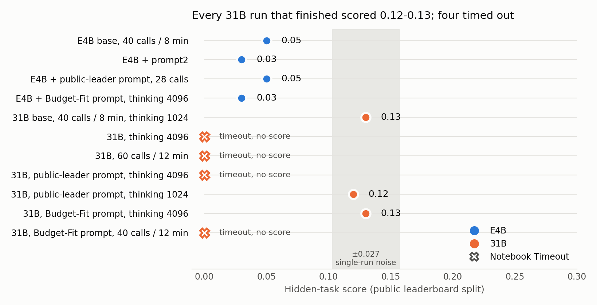

# Tool-Faithful Trajectory Distillation for a Small Gemma 4 SWE Agent: What Worked, What Silently Failed

*Subtitle: A harness bridge for frontier-teacher trajectories, a task-soundness audit, and negative results on commodity GPUs*

## Abstract

We ask whether a frontier coding agent can teach a small Gemma 4 model to use a fixed tool set. We run Claude Code as a teacher *inside* the official `swegemma` harness, exposing its nine tools through an MCP bridge so every teacher action is executed and logged by the sandbox the student is scored in, and verify each trajectory against the hidden tests. We QLoRA-finetune Gemma 4 E2B and E4B on commodity hardware (2x RTX 3060 12 GB; Kaggle T4) and evaluate with the scorer's own vLLM build.

Our main findings are negative or cautionary. (1) An empty-patch control caught an evaluation-environment bug: under bare `pytest` the installed `rich` wheel shadows the workspace, so 27 of the 30 `rich` public tasks we tested (all 18 training tasks, 9 of 12 held-out) pass with *no fix*, and every local resolution rate that included them was inflated; on the `fastapi` tasks that remain sound (35 for training, 12 held out), (2) none of our adapters, trained on Claude trajectories or on the model's own resolved runs, resolves more held-out tasks than the base model, and both submit patches less often. (3) We document four silent failure modes that cost us days: a vLLM build that ignores LoRA adapters without error, a chat template that leaves tool output trainable under response-only masking, repetition loops from small-data LoRA, and a dataset upload that silently kept stale data. (4) Switching to the 31B base model raised the hidden score from 0.05 to 0.13, and the scorer's 12-hour budget, not accuracy, then limited every larger-budget variant. We release the bridge, the sound-task list and the evaluation scripts.

## 1. Introduction

The Gemma 4 Developer Agent Competition asks for an offline software-engineering agent in the style of SWE-bench [7]: given an issue and a repository snapshot, produce a patch that passes hidden tests, on a fixed four-L4 machine with a 12-hour budget for all tasks [12]. We study the small end (E2B/E4B, which also qualifies for the small-model bonus) and ask a narrow question: can a frontier coding agent teach a small model *how to use a fixed tool set*, if the teacher acts through exactly the tools, caps and budget warnings the student will face?

We call this *tool-faithful distillation*. The teacher's observation space is identical to the student's: same 150-line read cap, same 5k-character command cap, same budget block, same system prompt. Our contributions are:

1. an MCP bridge that lets any tool-using agent (here Claude Code, headless) act inside the official `swegemma` sandbox, with every action executed, logged and verified by the scorer's own code;
2. an empty-patch soundness control for local evaluation, which exposed a wheel-shadowing bug that silently inflates local pass rates;
3. a documented set of silent failure modes in the Gemma 4 LoRA training and serving path on commodity GPUs;
4. controlled, repeated evaluations showing that, in our setting, distillation (from Claude, and from the student's own resolved runs) did not beat the base model.

## 2. Related work

Agent-trajectory distillation for SWE tasks is well established at larger scale: SWE-Gym [1] fine-tunes a 32B model on 491 trajectories and reports a 13.6-point gain; SWE-smith [2] reports 15.2 on SWE-bench Verified with 2k trajectories for a 7B model; SWE-Next [3] full-finetunes 7B/14B models on 3.7k Claude/GPT trajectories (17.4 / 30.0 Verified). Open-SWE-Traces [4] reports that training on all trajectories, unresolved included, beats resolved-only for its model family, and SWE-Prime [5] that a selected 10 % subset can beat the full resolved set. All use full fine-tuning on far larger hardware than ours; a study of trajectory curation for LoRA-tuned 7B code agents [13] finds quality filtering pays only beyond about 2k trajectories, far above our 62 episodes. For small-data LoRA, *LoRA Without Regret* [6] reports parity with full fine-tuning when MLP layers are adapted; we adapt attention and MLP (LoRA [8], QLoRA [9]).

## 3. Method

### 3.1 Harness-faithful teacher
`teacher/harness_env.py` reuses the harness bootstrap (Container A), the tool factory and the prompt builder. An MCP server (`teacher/mcp_server.py`) exposes the nine tools with the student's docstrings, over streamable HTTP; Claude Code runs headless with all built-in tools disabled, so every action goes through the sandbox. Verification runs the hidden tests in a fresh Container B with per-snapshot pinned dependencies (Sec. 5).

### 3.2 Episode rendering
Episodes are OpenAI-style messages plus tool schemas derived from the ADK tool definitions, rendered with Gemma 4's native chat template (`<|tool_call>call:name{...}<tool_call|>`, `<|tool_response>`). The teacher's visible text before a call becomes a short thought (≤1,200 characters). Long episodes are split into overlapping windows at turn boundaries (3.8k-8k tokens) instead of being dropped.

### 3.3 Training
Unsloth [10] QLoRA on E2B (local 3060) and E4B (Kaggle T4): rank 16, α 16, attention and MLP projections, lr 1e-4 to 2e-4, 2 to 3 epochs, loss on model turns only with tool-response spans explicitly masked (Sec. 6). The adapter's `base_model_name_or_path` is rewritten to the W4A16 checkpoint the harness serves, and target modules to an explicit list.

### 3.4 Evaluation and submission
A single `LlmAgent` with the nine tools, 40 tool calls, 8 minutes and 60 turns per task, temperature 0.3, thinking budget 1,024. Evaluation uses the scorer's own vLLM wheel, not a generic container, after our adapter-effect check (Sec. 6).

## 4. Experiments

**Data.** Teacher: Claude Code (headless, subscription) on the public `fastapi` and `rich` tasks, up to two samples per task. Resolved = hidden tests pass in a fresh Container B. First sample: 30 of 55 non-held-out `fastapi` tasks and 18 `rich` tasks resolved; second sample on `fastapi`: 35 of 55. The empty-patch control (Sec. 5) removed all 18 `rich` tasks and 3 `fastapi` tasks, leaving **35 sound `fastapi` tasks / 62 episodes** (151 windows at a 3.8k-token cap). On-policy data: 140 E4B-base runs on the 35 sound tasks (4 per task, T=0.5) gave 23 resolved runs on only 8 distinct tasks (7.6 tool calls on average, all ending in an explicit `submit_patch`), 57 windows.

**Evaluation.** 12 held-out `fastapi` tasks never used in training, run through the official harness (`EvalConfig`, ADK compaction, 8 min / 40 calls) against the scorer's vLLM wheel; adapters served as LoRA modules. We report resolved, patches submitted, timeouts and mean tool calls.

| Model | Resolved /12 | Patches | Timeouts | Mean calls |
|---|---|---|---|---|
| E2B base | 0 | 10 | 1 | 9 |
| E2B + Claude data v1 / v2 (freq. penalty) / v3 / v3 (freq. penalty) | 0 / 0 / 0 / 0 | 7 / 1 / 4 / 4 | 6 / 3 / 8 / 1 | 11 / 19 / 21 / 29 |
| **E4B base** (3 runs) | **2 / 0 / 0** | 10 / 11 / 10 | 1 / 0 / 1 | 15 / 12 / 12 |
| E4B + Claude data (v3c, 3 runs) | 0 / 0 / 0 | 3 / 3 / 2 | 3 / 2 / 1 | 22 / 25 / 25 |
| E4B + on-policy (onpol, 3 runs) | 0 / 0 / 0 | 7 / 6 / 4 | 4 / 0 / 1 | 16 / 8 / 10 |
| E4B base + prompt2 (3 runs) | 0 / 1 / 1 | 11 / 12 / 12 | 1 / 0 / 0 | 13 / 12 / 13 |
| 12B base (40 calls / 8 min, 3 runs) | 1 / 0 / 0 | 8 / 6 / 5 | 5 / 9 / 8 | 33 / 30 / 28 |
| 12B v2 (60 calls / 12 min + early-submit prompt, 4 runs) | 1 / 1 / 0 / 1 | 6 / 9 / 9 / 9 | 5 / 5 / 6 / 6 | 37 / 42 / 47 / 48 |

Three runs of the *same* E4B base configuration gave 2, 0 and 0 resolved tasks, so differences of one or two tasks on 12 are indistinguishable from noise. What the table does show, in all three repeats of each adapter, is a consistent drop in submitted patches after finetuning (base 10-11 against 2-3 for v3c and 4-7 for on-policy), more timeouts, and for v3c roughly twice the tool calls per task. Neither adapter resolved a held-out task in 3 x 12 trials (base: 2 of 36). We did not reproduce the intended effect of distillation. `prompt2` (two added rules aimed at the collection-error mode below) resolved 2 of 36, the same as base.

**Hidden-task score.** The unmodified E4B base submission (no LoRA, harness-tuned prompt, 40 calls / 8 min / 60 turns, T=0.3) scored **0.05** on the public split (about 58 tasks) of the competition's ~120 hidden private-repo tasks. Our local estimate for the same configuration was 2 of 36 held-out trials (5.6 %), matching the hidden rate. The `prompt2` variant, which matched base locally (2 of 36), scored **0.03**, within noise. The public-leader prompt on E4B (28 calls, thinking 1024) also scored **0.05**, and resolved 5 of 47 sound `fastapi` tasks locally, as base did. The Budget-Fit prompt (thinking 4096) resolved 9 of 47 locally yet scored **0.03**: local gains did not transfer.

**Larger model.** The competition also permits the 12B and 31B quantized models. Locally, 12B resolved 4 of 84 trials against 2 of 36 for E4B base, with two to three times the tool calls and 5-9 of 12 tasks per run timing out (0 of 36 with the v6 prompt). In contrast, the unmodified **31B** base submission, with the same prompt and budgets as the E4B baseline (40 calls / 8 min / 60 turns), scored **0.13** on the hidden tasks, against 0.05 for E4B base. Model size is the largest effect we measured; local 12B did not predict it. 31B does not fit our GPUs, so we evaluated it on a four-L4 Kaggle notebook over all 129 public tasks: 31 resolved (0.24) at the baseline budgets, with 51 errors, nearly all of them the 8-minute session timeout. Raising the budgets to 60 calls / 12 min / 90 turns resolved 38 (0.29), a gain of one to two standard errors. Public tasks are easier than private ones (0.24 locally, 0.13 hidden), so figures compare configurations only. One public task is 0.017 and one run carries about ±0.027; the final ranking uses the other ~62 tasks. A public census reports ten draws of one 31B file set ("Budget-Fit") averaging 0.166, range 0.13-0.18, and our own submission of that exact file set scored **0.13**, so our 0.12 and 0.13 runs sit within one run's noise of that mean.

**Budgets on the scorer.** Larger budgets did not survive it (Figure 1). Four of seven 31B submissions ended in "Notebook Timeout" with no score: thinking 4096, 12 minutes / 60 calls, the public-leader configuration (thinking 4096, 28 calls), and Budget-Fit with 40 calls / 12 minutes. Budget-Fit finished at 28 calls / 8 min but not at 40 / 12; the public-leader configuration finished all 129 public tasks on our four-L4 replica in 3.5 h yet timed out on the scorer. The scorer is slower than a replica, or the hidden tasks are; a public gain is worthless if the run does not finish.

**Prompts and edit timing.** A public notebook (`gemma-4-baseline-lb-0-24`) uses a tighter budget (28 calls, 8 min, no graph tools, edit by call 12); on our replica it resolved 29 of 129, no better than the baseline (31). With thinking 1024 the same prompt resolved 31 of 129 (27 empty patches, 33 errors); that version scored **0.12** on the hidden tasks, no gain over the 0.13 baseline. In that run, tasks whose first edit came by call 12 resolved 17 of 43, and tasks editing at call 21 or later, or never, resolved 5 of 52. A firmer variant (first edit by call 8, no re-reads) cut empty patches from 27 to 15 but resolved 28, not 31.

*Figure 1. Hidden public-split score per submission; crosses are scorer timeouts; the grey band is single-run noise (±0.027).*

**Failure taxonomy (E4B base, 3 runs x 12 tasks = 36 trials).** 2 resolved; 29 submitted a patch that failed the hidden tests; 5 produced no patch. Of the 29 failed patches, 15 end in a pytest *collection error* (exit code 2): the hidden tests import a module or name that the patch does not provide (e.g. `ModuleNotFoundError: scripts.prepare_release`, `cannot import name 'AnyUrl' from fastapi._compat.v1`). The other 14 run and fail assertions. So about half of the failures are interface mismatches that a patch can avoid by creating exactly the module or symbol the issue names, not wrong logic.

## 5. Released resources

All under Apache 2.0, at github.com/jctux/gemma4-tool-faithful-distill (code) and kaggle.com/datasets/tuxmx1/gemma4-tool-faithful-distill (data). (i) The **harness bridge**: an MCP server exposing the nine `swegemma` tools over streamable HTTP, so any tool-using agent acts inside the scoring sandbox with every call logged; with it the verifier, the empty-patch control, and a gold-patch audit with per-snapshot dependency pins (older snapshots break under the harness's newest-wheel installs). (ii) **Task lists**: the 35 sound `fastapi` training tasks, the 12 held-out tasks, and the audit index over all 129 public tasks. (iii) **Run outputs**: per-task results of every held-out run in the table, of the two 129-task 31B replicas (with tool-call traces), and the exact file set of every hidden-task submission. (iv) The two E4B adapters and the 23 on-policy episodes; teacher-run metadata is released, the Claude-generated text is not.

## 6. Pitfalls we measured

1. **Serving-build mismatch silently disables LoRA.** A Docker `vllm:0.19.1` [11] and the competition wheelhouse `vllm 0.19.1` wheel differ in `lora/model_manager.py`, `gemma4.py` and `gemma4_mm.py` (md5). On the Docker image the adapter had no effect (identical log-probs to 6 decimals, even after scaling B by 100) and `Gemma4ForConditionalGeneration` reported "does not support LoRA yet". On the scorer's wheel, the same adapter moved greedy log-prob of an 80-token continuation from -24.9 (base) to -5.5. We recommend a log-prob effect check against the *exact scorer build* before any evaluation (cf. vLLM issues #41754, #39815).
2. **Response-only masking is not enough for Gemma 4 agent data.** The chat template renders tool results *inside* the model turn, so the standard `<|turn>model` response mask leaves them trainable: 45.7 % of tokens were trainable but only 10.7 % are the model's own actions. Our first adapters (v1) trained on tool output; v2 masks `<|tool_response>...<tool_response|>` explicitly.
3. **Small-data LoRA can induce repetition loops.** v2 (3 epochs, lr 2e-4, 90 windows) looped at T=0.3 in 4/4 first-turn samples; `frequency_penalty=0.3` removed the loops (0/4); v1 and base did not loop.
4. **Task soundness needs an empty-patch control**, not only a gold-patch pass.
5. **Stale data uploads.** A failing dataset-status call made our script take the `create` branch, which silently fails on an existing dataset, so two training runs consumed old data. We now try `version` first and check the episode count in the training log.

## 7. Limitations

- **Tiny, noisy evaluation.** 12 held-out tasks, a base resolve rate near 8 %, and a measured 2-vs-0 swing between identical runs. Our comparisons cannot detect effects below a few tasks.
- **One repository family.** Only `fastapi` tasks are sound in our environment; `rich` tasks pass with an empty patch locally, and the community audit reports them sound, so the cause is an environment difference. Cause: the sandbox has the newest `rich` wheel (15.0.0), which already contains the fixes; bare `pytest` on `rich_3052` with the test patch and no fix imports that wheel and passes 7 of 7, while `python -m pytest` (workspace first on the path) fails correctly.
- **Small training data.** 35 tasks; on-policy data covers 8 tasks. We cannot separate "distillation does not help" from "too little data".
- **Local scale.** E2B/E4B QLoRA at 4k-8k tokens, one seed; seven hidden-task scores (Figure 1) plus four timed-out 31B submissions; adapters and 12B have none (one submission per day). The 31B budget comparisons are one run per arm on public tasks.

## 8. Conclusion

Tool-faithful teacher trajectories are cheap to collect and verify, and the bridge works with any tool-using agent. In our setting, however, finetuning small Gemma 4 models on them did not beat the base model, while switching to the 31B base model raised the hidden score from 0.05 to 0.13, after which the scorer's 12-hour budget limited every larger-budget variant. The bigger lesson is methodological: control for task soundness, verify the serving build really applies the adapter, mask tool output explicitly, and verify that each data upload actually changed the dataset.

## Reproducibility

Code and data: Sec. 5. Public notebook: https://www.kaggle.com/code/tuxmx1/kagle-distill-pitfalls (data: https://www.kaggle.com/datasets/tuxmx1/kagle-distill-notebook-data).

## References

[1] J. Pan, X. Wang, G. Neubig, et al. Training Software Engineering Agents and Verifiers with SWE-Gym. arXiv:2412.21139, 2024.
[2] J. Yang, K. Lieret, C. E. Jimenez, et al. SWE-smith: Scaling Data for Software Engineering Agents. arXiv:2504.21798, 2025.
[3] J. Liang, Z. Lyu, Z. Liu, et al. SWE-Next: Scalable Real-World Software Engineering Tasks for Agents. arXiv:2603.20691, 2026.
[4] W. U. Ahmad, N. Ludwig, S. Majumdar, et al. Open-SWE-Traces: Advancing Dual-Mode Multilingual Distillation for Software Engineering Agents. arXiv:2606.16038, 2026.
[5] D. Zheng, R. Ye, Y. Wang, et al. SWE-Prime: Fewer Trajectories, Better Performance. arXiv:2608.27449, 2026.
[6] J. Schulman and Thinking Machines Lab. LoRA Without Regret. Thinking Machines Lab: Connectionism, 29 Sep 2025. https://thinkingmachines.ai/blog/lora/ (doi:10.64434/tml.20250929).
[7] C. E. Jimenez, J. Yang, A. Wettig, et al. SWE-bench: Can Language Models Resolve Real-World GitHub Issues? arXiv:2310.06770, 2023 (ICLR 2024).
[8] E. J. Hu, Y. Shen, P. Wallis, et al. LoRA: Low-Rank Adaptation of Large Language Models. arXiv:2106.09685, 2021 (ICLR 2022).
[9] T. Dettmers, A. Pagnoni, A. Holtzman, L. Zettlemoyer. QLoRA: Efficient Finetuning of Quantized LLMs. arXiv:2305.14314, 2023 (NeurIPS 2023).
[10] D. Han, M. Han, and the Unsloth team. Unsloth. https://github.com/unslothai/unsloth.
[11] W. Kwon, Z. Li, S. Zhuang, et al. Efficient Memory Management for Large Language Model Serving with PagedAttention. arXiv:2309.06180, 2023 (SOSP 2023).
[12] Google DeepMind. Gemma 4 Developer Agent Competition (HARNESS_README and rules). Kaggle, 2026. https://www.kaggle.com/competitions/gemma-4-developer-agent
[13] Y. Han. A Systematic Evaluation of Trajectory Data Curation for LoRA Fine-Tuning of Code Agents. arXiv:2607.17205, 2026 (ICIC 2026).
